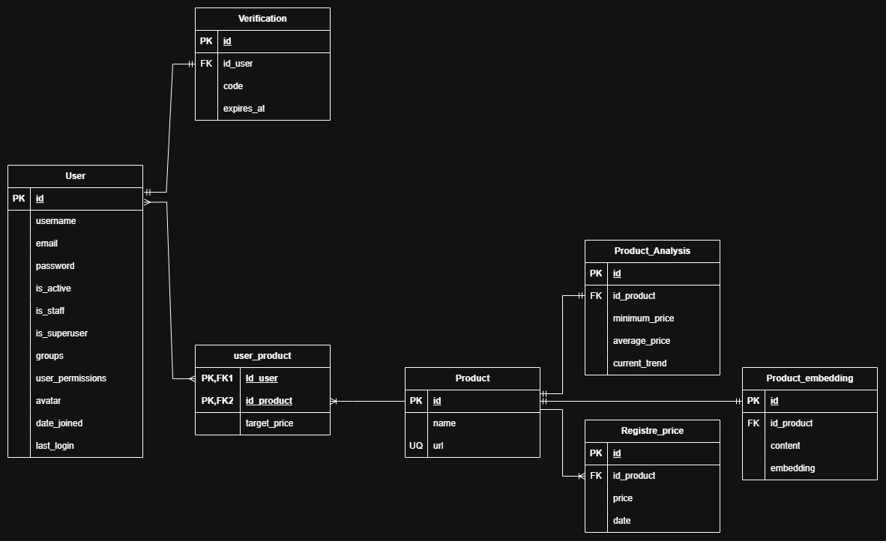

# Track Your Products

Full-Stack system designed for product price tracking, analysis, and monitoring in real time, featuring personalized alerts and advanced AI capabilities.

## Technologies

### Backend
- **Python 3.15** & **Django / Django Ninja** — Fast, asynchronous, and typed REST API.
- **PyJWT** — Secure authentication via JSON Web Tokens.
- **Postgres** — Relational database for persistence.
- **Django Mail** — Transactional email delivery and verification codes.

### Frontend
- **Next.js** — React framework for server rendering and routing.
- *(Additional client-side technologies to be defined)*

### Artificial Intelligence
- **Embeddings & Vector Search** — Vector storage (`Product_embedding`) for semantic search, recommendations, and product content analysis.

## Data Model (Entity-Relationship Diagram)

The database architecture is designed to handle users, product tracking, price histories, and AI vectors:

### Schema Overview:
- **User & Verification**: Registration, login, and email verification history.
- **Product & user_product**: Many-to-many relationship allowing users to set a custom `target_price` for each product.
- **Registre_price**: Historical price tracking ordered by date.
- **Product_Analysis**: Consolidated metrics (minimum price, average price, and current trend).
- **Product_embedding**: Vectors and content for advanced language model features.
