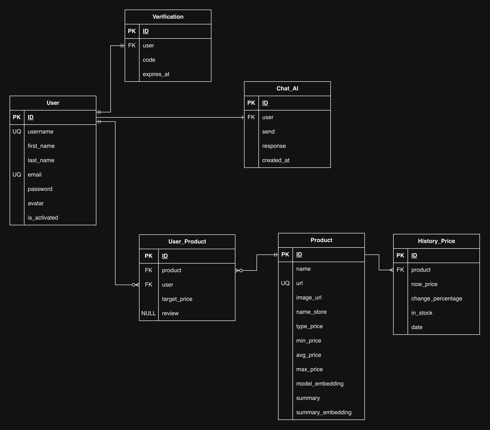

# Track Your Products

Full-stack system designed for real-time product price tracking, analysis, and monitoring, featuring personalized alerts and advanced AI capabilities.

## Technologies

### Backend
- **Python** & **Django / Django Ninja** — Fast, asynchronous, and typed REST API.
- **PyJWT** — Secure authentication via JSON Web Tokens.
- **PostgreSQL** — Relational database with `pgvector` support for AI workloads.
- **Django Mail** — Transactional email delivery and verification codes.

### Frontend
- **Next.js** — React framework for server rendering and routing.
- **js-cookie** — Lightweight client-side library for managing browser cookies.

### Artificial Intelligence & Data
- **Embeddings & Vector Search** — Vector storage (`Product_embedding`) for semantic search, recommendations, and product content analysis.

---

## Deployment
- **Containerization**: Built with Docker and orchestrated via Docker Compose for production environments.
- **Reverse Proxy Architecture**: Uses an isolated Nginx container per project mapped to port 80, routing traffic dynamically to the internal frontend (`Next.js`) and backend (`Django`) services.
- **Database Persistence**: Managed via a dedicated PostgreSQL container with `pgvector` extension and persistent volume storage.
- **Environment Isolation**: Secure configuration through dedicated `.env` files and internal Docker bridge networks.

---

## Data Model (Entity-Relationship Diagram)

The database architecture is designed to handle users, product tracking, price histories, and AI vectors:

### Schema Overview:
- **User & Verification**: Registration, login, and email verification history.
- **Product & user_product**: Many-to-many relationship allowing users to set a custom `target_price` for each product.
- **Registre_price**: Historical price tracking ordered by date.
- **Product_Analysis**: Consolidated metrics (minimum price, average price, and current trend).
- **Product_embedding**: Vectors and content for advanced language model features.